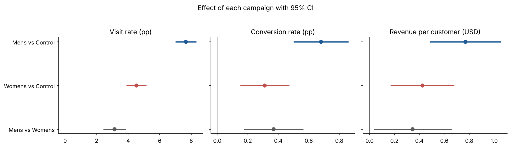
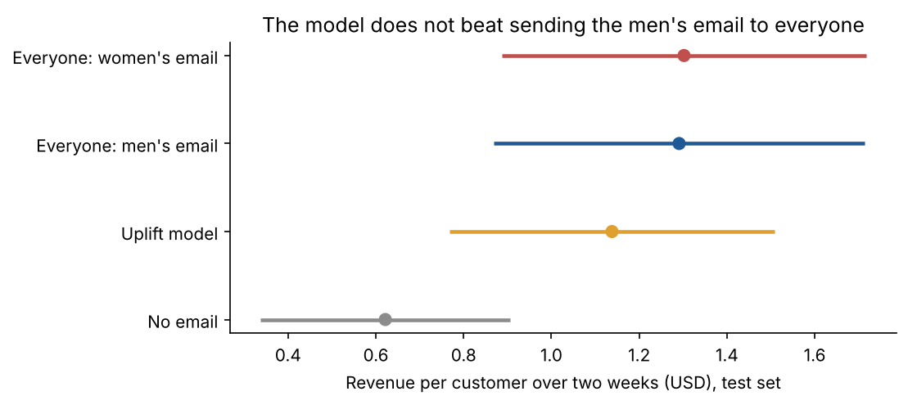

# Email Campaigns: Analysis of an A/B/n Experiment

An online clothing retailer had two email campaigns, one featuring men's merchandise and one featuring women's, and wanted to know whether they were worth sending, which of the two, and to whom. To find out, it took 64,000 customers and split them at random into three groups: some got the men's email, some got the women's email, and some got nothing. Two weeks later it measured who visited the site, who bought and how much they spent.

This repository is my analysis of that experiment, from checking that it was run correctly to estimating how much money each decision is worth.

Tools: PostgreSQL and Python (pandas, NumPy, SciPy, scikit-learn, matplotlib). At the end, the notebooks export tables ready to build a report in Power BI.

---

## The short answer

Send the men's email to the whole list. It brings in about 770 USD of additional revenue per 1,000 emails, almost double the women's email, and I found no customer segment where doing something else pays off.

| | No email | Women's email | Men's email |
|---|---|---|---|
| Visit rate | 10.6% | 15.1% | 18.3% |
| Conversion rate | 0.57% | 0.88% | 1.25% |
| Revenue per customer (2 weeks) | $0.65 | $1.08 | $1.42 |
| Incremental revenue per 1,000 emails | — | $424 | $770 |

On a list the size of the experiment's, that comes to about 49k USD of additional revenue over two weeks (95% CI: 31k to 67k).



## How I got there

### First, make sure the experiment could be trusted

Before comparing results, I wanted to rule out a badly run experiment, because if random assignment failed, any difference between groups could be due to something else. The three groups came out almost the same size (21,306 / 21,307 / 21,387; SRM test, p = 0.90) and are comparable on every variable measured before the send (largest standardized difference: 0.014).

I also found an important warning: more than 99% of customers buy nothing, so revenue per customer is very noisy. With this sample size, the experiment could only detect effects of about 0.31 USD per customer (48% of control) with 80% power. Power for visits is much higher. That forced me to be careful with any conclusion about small groups.

To avoid fitting the analysis to the results, I wrote the [analysis plan](docs/analysis_plan.md) before computing any effect: which metrics, which tests and which decision criterion.


### Then, measure whether the campaigns work

Both work. Compared with sending no email, both increase visits, purchases and revenue, and all nine comparisons remain significant after adjusting for multiple comparisons with the Holm method.

The men's email wins clearly: +0.77 USD per customer versus control (95% CI: 0.49 to 1.05), against +0.42 for the women's email. The difference between the two (+0.35 USD, 95% CI: 0.03 to 0.66) is also significant (adjusted p = 0.03).

I wanted to know where that effect came from. Average order value is similar across the three groups, so the email seems to work because more people buy, not because each buyer spends more. I treat this as descriptive, because order value is only computed over customers who bought.

To check that the result did not depend on the method, I recomputed the intervals with a bootstrap (10,000 replicates), which differ from the Welch intervals by less than 0.01 USD, and capped spend at the 95th percentile of buyers. No conclusion changed.

### The temptation to personalize

The natural next step was to ask whether some customers respond better to one email than the other. If so, sending each customer the email that suits them would bring in more money than sending everyone the same one.

To avoid fooling myself with chance results, I split the sample at random into two halves: one to explore and one to confirm. In the first half, two differences for the women's email looked promising (new customers and purchase channel, p < 0.10). In the confirmation half, neither repeated (p = 0.72 and 0.94). I only used variables measured before the send, because segmenting by something the email could have changed, such as having visited the site, would break the randomization.

I also tried an uplift model (T-learner) that picks the email for each customer. I tuned it on a validation set and evaluated it once on 30% of the data it had never seen. It did not beat the simple rule either: −0.15 USD per customer (95% CI: −0.41 to +0.10).

As an exploratory check, the men's email has a positive effect in all 18 segments reviewed and is the best in 15. Given the power available per segment, not finding differences does not prove they don't exist, but it does mean there is no evidence to justify a more complicated strategy.



### Finally, translate it into money

The experiment has no cost data, so I set up scenarios. With a 30% margin and using the lower bound of the interval, the campaign still makes a profit as long as each email costs less than about 0.15 USD. In other words, the recommendation holds even under conservative assumptions.

## What I would do next

I would test an improved version of the men's email against the current one, always keeping a no-email group to keep measuring the incremental effect, and I would add the list unsubscribe rate as a guardrail metric.

## Limitations

- The experiment is from 2008; the response to email is different today.
- There is no data on costs, margins, list unsubscribes or spam complaints. The margin and cost scenarios are assumptions and are labeled as such.
- The window is two weeks: it does not measure long-term effects or whether purchases were simply pulled forward.
- Spend appears to be capped at 499 USD (12 buyers at that value).

---

## Where each part lives

| Question | Method | Notebook |
|---|---|---|
| Is the experiment valid? | Sample ratio mismatch, covariate balance, statistical power | [01_validation](notebooks/01_validation.ipynb) |
| Do the campaigns work? Which is better? | Proportion and Welch tests, Holm adjustment, bootstrap, sensitivity to extremes | [02_analysis](notebooks/02_analysis.ipynb) |
| Who should get what? How much is it worth? | Interactions with a confirmation sample, T-learner evaluated with IPW, margin and cost scenarios | [03_segments_and_impact](notebooks/03_segments_and_impact.ipynb) |

## How to reproduce it

```bash
git clone https://github.com/cdtorrespi/hillstrom-email-ab-test.git
cd hillstrom-email-ab-test
python -m venv .venv && source .venv/bin/activate   # on Windows: .venv\Scripts\activate
pip install -r requirements.txt
python src/download_data.py   # validates the included CSV (or downloads it if missing)
jupyter notebook notebooks/
```

The CSV is already in `data/raw/`. If you delete it and the automatic download fails, get the CSV from the [MineThatData blog](https://blog.minethatdata.com/2008/03/minethatdata-e-mail-analytics-and-data.html) and save it as `data/raw/hillstrom.csv`.

SQL part (optional; run from the repo root because the load uses a relative path):

```bash
createdb hillstrom
psql -d hillstrom -f sql/01_create_table.sql
psql -d hillstrom -f sql/02_data_quality.sql
psql -d hillstrom -f sql/03_exploration.sql
```

## Structure

```
hillstrom-email-ab-test/
├── README.md
├── requirements.txt
├── data/raw/hillstrom.csv    # original data (64,000 customers)
├── docs/
│   └── analysis_plan.md      # metrics, hypotheses and criteria fixed before the analysis
├── sql/
│   ├── 01_create_table.sql   # schema and load in PostgreSQL
│   ├── 02_data_quality.sql
│   └── 03_exploration.sql
├── src/
│   ├── download_data.py
│   ├── dataset.py            # loading and constants
│   └── stats_utils.py        # tests, bootstrap, Holm, robust OLS
├── notebooks/
│   ├── 01_validation.ipynb
│   ├── 02_analysis.ipynb
│   └── 03_segments_and_impact.ipynb
└── reports/
    ├── figures/
    └── powerbi/              # tables for the decision report
```

## Data

Kevin Hillstrom, *MineThatData E-Mail Analytics and Data Mining Challenge* (2008). Public dataset of 64,000 customers who had bought in the past 12 months, randomly assigned to three groups and followed for two weeks after the send.

## Author

Carlos Daniel Torres Pillado, data analyst. Chihuahua, Mexico.

- GitHub: [@cdtorrespi](https://github.com/cdtorrespi)
- Email: [cdtorres.pi@gmail.com](mailto:cdtorres.pi@gmail.com)
