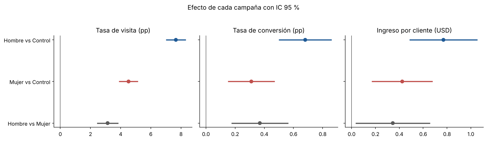
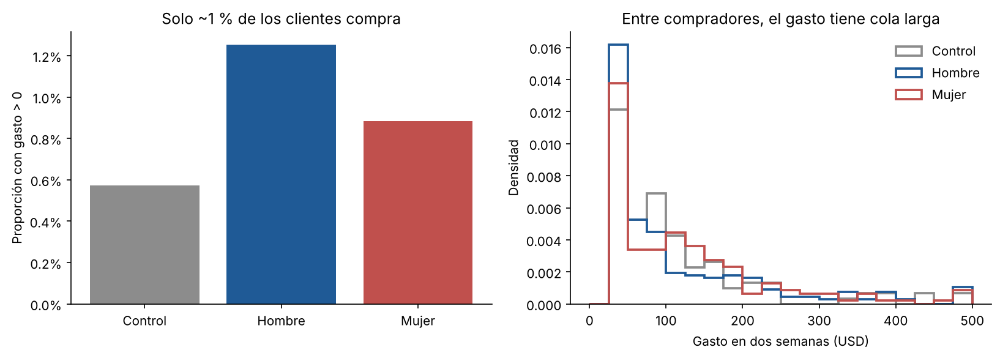
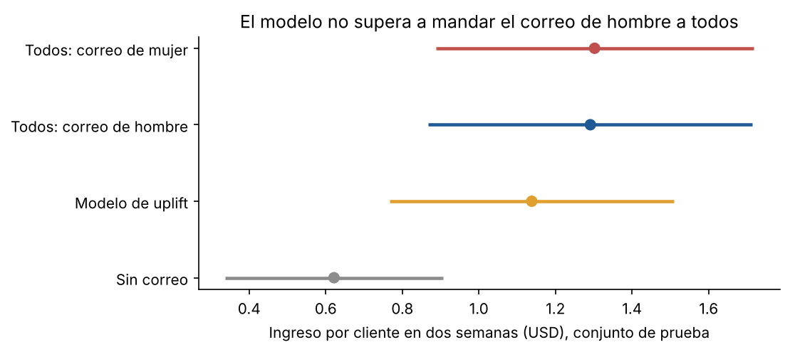

# Campañas por correo: análisis de un experimento A/B/n

Análisis de un experimento aleatorizado de una tienda de ropa en línea con 64,000 clientes y tres grupos: correo con mercancía de hombre, correo con mercancía de mujer y sin correo. El objetivo es decidir si conviene mandar campañas, cuál y a quién, con el impacto estimado en dinero.

**Herramientas:** PostgreSQL · Python (pandas, NumPy, SciPy, scikit-learn, matplotlib) · Power BI

---

## Resumen ejecutivo

**Decisión: mandar el correo de hombre a toda la base.**

| | Sin correo | Correo de mujer | Correo de hombre |
|---|---|---|---|
| Tasa de visita | 10.6 % | 15.1 % | **18.3 %** |
| Tasa de conversión | 0.57 % | 0.88 % | **1.25 %** |
| Ingreso por cliente (2 semanas) | $0.65 | $1.08 | **$1.42** |
| Ingreso incremental por cada 1,000 correos | — | $424 | **$770** |

- **Las dos campañas funcionan.** Frente a no mandar correo, ambas aumentan visitas, compras e ingreso, y las nueve comparaciones siguen siendo significativas después de ajustar por comparaciones múltiples (Holm dentro de cada métrica).
- **El correo de hombre es el mejor:** +0.77 USD por cliente frente al control (IC 95 %: 0.49 a 1.05), contra +0.42 del de mujer. La diferencia entre ambos (+0.35 USD, IC 95 %: 0.03 a 0.66) es significativa (p ajustado = 0.03).
- **Los datos sugieren que el efecto viene de más compradores**, no de compras más grandes: el ticket promedio es similar en los tres grupos (descriptivo, porque el ticket se calcula solo sobre compradores).
- **No hay evidencia de que convenga personalizar por segmento.** Dos diferencias entre segmentos parecían prometedoras en una mitad de los datos y ninguna se repitió en la otra mitad. Un modelo de uplift que elige el correo por cliente tampoco supera a la regla simple (−0.15 USD por cliente, IC 95 %: −0.41 a +0.10).
- **La decisión es robusta a los costos.** Con un margen de 30 % y el límite inferior del intervalo, la campaña deja ganancia mientras cada correo cueste menos de ~0.15 USD.

En una lista como la del experimento, mandar el correo de hombre a todos genera unos **49 mil USD adicionales en dos semanas** (IC 95 %: 31 mil a 67 mil).



---

## Preguntas y cómo se respondieron

| Pregunta | Método | Notebook |
|---|---|---|
| ¿El experimento es válido? | Sample ratio mismatch, balance de covariables, poder estadístico | [01_validacion](notebooks/01_validacion.ipynb) |
| ¿Funcionan las campañas? ¿Cuál es mejor? | Pruebas de proporciones y de Welch, ajuste de Holm, bootstrap, sensibilidad a extremos | [02_analisis](notebooks/02_analisis.ipynb) |
| ¿A quién mandar qué? ¿Cuánto vale? | Interacciones con muestra de confirmación, T-learner evaluado con IPW, escenarios de margen y costo | [03_segmentos_e_impacto](notebooks/03_segmentos_e_impacto.ipynb) |

El plan de análisis se escribió antes de calcular efectos: [`docs/plan_de_analisis.md`](docs/plan_de_analisis.md).

## Hallazgos por etapa

### 1. Validación

- La asignación quedó balanceada: 21,306 / 21,307 / 21,387 clientes (prueba de SRM, p = 0.90).
- Los grupos son comparables en todas las variables previas al envío (diferencia estandarizada máxima: 0.014).
- Más del 99 % de los clientes no compra, así que el ingreso por cliente es muy ruidoso: el experimento solo podía detectar efectos de ~0.31 USD por cliente (48 % del control) con 80 % de poder. Para las tasas de visita el poder es mucho mayor.



### 2. Efectos principales

- Las tres comparaciones (hombre vs control, mujer vs control, hombre vs mujer) son significativas en las tres métricas después del ajuste de Holm.
- Los intervalos bootstrap (10,000 réplicas) difieren de los de Welch en menos de 0.01 USD.
- Acotar el gasto al percentil 95 de los compradores reduce los efectos ligeramente y no cambia ninguna conclusión.

### 3. Segmentos y uplift

- Solo uso variables medidas antes del envío. Segmentar por algo que el correo pudo cambiar, como haber visitado el sitio, rompería la aleatorización.
- Dividí la muestra al azar en dos mitades: en la de exploración, dos interacciones del correo de mujer (cliente nuevo y canal de compra) salieron con p < 0.10. **En la de confirmación ninguna se repitió** (p = 0.72 y 0.94).
- De forma exploratoria, el correo de hombre tiene efecto estimado positivo en los 18 segmentos revisados y es el mejor en 15. El poder por segmento es bajo, así que no encontrar diferencias no prueba que no existan.
- El modelo de uplift (T-learner) se eligió en un conjunto de validación y se evaluó una sola vez en un 30 % de datos no vistos. No mejora a mandar el correo de hombre a todos.



## Limitaciones

- El experimento es de 2008; la respuesta al correo electrónico hoy es distinta.
- No hay datos de costos, márgenes, bajas de la lista ni quejas de spam. Los escenarios de margen y costo son supuestos y están marcados como tales.
- La ventana es de dos semanas: no mide efectos de largo plazo ni si las compras solo se adelantaron.
- El gasto parece estar topado en 499 USD (12 compradores en ese valor).

## Siguiente paso recomendado

Probar una versión mejorada del correo de hombre contra la actual, manteniendo un grupo sin correo para seguir midiendo el efecto incremental. Agregar como guardrail la tasa de bajas de la lista.

---

## Cómo reproducirlo

```bash
git clone https://github.com/cdtorrespi/hillstrom-email-ab-test.git
cd hillstrom-email-ab-test
python -m venv .venv && source .venv/bin/activate   # en Windows: .venv\Scripts\activate
pip install -r requirements.txt
python src/descargar_datos.py   # valida el CSV incluido (o lo descarga si falta)
jupyter notebook notebooks/
```

El CSV ya viene en `data/raw/`. Si lo borras y la descarga automática falla, baja el CSV del [blog de MineThatData](https://blog.minethatdata.com/2008/03/minethatdata-e-mail-analytics-and-data.html) y guárdalo como `data/raw/hillstrom.csv`.

**Parte de SQL (opcional, desde la raíz del repo porque la carga usa una ruta relativa):**

```bash
createdb hillstrom
psql -d hillstrom -f sql/01_crear_tabla.sql
psql -d hillstrom -f sql/02_calidad_datos.sql
psql -d hillstrom -f sql/03_exploracion.sql
```

## Estructura

```
hillstrom-email-ab-test/
├── README.md
├── requirements.txt
├── data/raw/hillstrom.csv    # datos originales (64,000 clientes)
├── docs/
│   └── plan_de_analisis.md   # métricas, hipótesis y criterios fijados antes del análisis
├── sql/
│   ├── 01_crear_tabla.sql    # esquema y carga en PostgreSQL
│   ├── 02_calidad_datos.sql
│   └── 03_exploracion.sql
├── src/
│   ├── descargar_datos.py
│   ├── datos.py              # carga y constantes
│   └── estadistica.py        # pruebas, bootstrap, Holm, MCO robusto
├── notebooks/
│   ├── 01_validacion.ipynb
│   ├── 02_analisis.ipynb
│   └── 03_segmentos_e_impacto.ipynb
└── reports/
    ├── figures/
    └── powerbi/              # tablas para el reporte de decisión
```

## Datos

Kevin Hillstrom, *MineThatData E-Mail Analytics and Data Mining Challenge* (2008). Dataset público de 64,000 clientes que compraron en los últimos 12 meses, asignados al azar a tres grupos y seguidos durante dos semanas después del envío.
